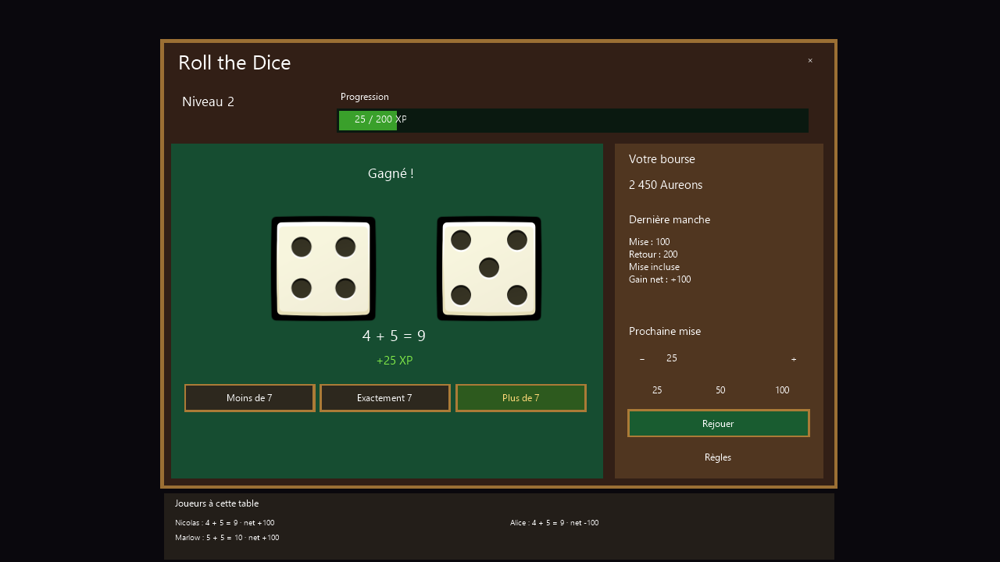

# Roll the Dice

Roll the Dice est une table de 1 à 6 joueurs, avec des lancers individuels. Chaque joueur choisit son pari et sa mise, puis voit ses deux dés et les derniers résultats des autres joueurs de la même table. Les soldes et l’XP restent individuels. Une table est identifiée par sa carte, son instance, son identifiant d’événement et sa monnaie.

## Règles et équilibrage

| Pari | Total | Couples gagnants sur 36 | Retour total par défaut |
| --- | --- | --- | --- |
| Moins de 7 | 2–6 | 15 | 2 × la mise |
| Exactement 7 | 7 | 6 | 5 × la mise |
| Plus de 7 | 8–12 | 15 | 2 × la mise |

Les retours comprennent la mise. Avec 4 + 5, un pari « Plus de 7 » de 100 Aureons retourne 200 Aureons, pour un gain net de 100. Une défaite retourne zéro et son gain net vaut moins la mise. Le multiplicateur 5 est le choix d’équilibrage initial proposé dans le mandat, à revoir avant mise en production. Les deux dés sont indépendants et uniformes ; le niveau ne change jamais leurs probabilités.

Réglages initiaux : mise minimale 25, maximale 1 000, pas 25, raccourcis 25/50/100. Les limites doivent être divisibles par le pas. L’éditeur permet de changer les deux multiplicateurs de retour, les limites, le pas, le droit d’entrée, la réserve et le nombre de places.

La progression `roll_the_dice` utilise les règles partagées : 25 XP par victoire avant bonus d’activité, niveaux 1 à 25, seuil cumulé `50 × L × (L − 1)`, plafond 30 000 XP. Le reçu conserve l’XP réellement ajoutée, y compris au plafond. L’interface calcule la barre entre les seuils du niveau courant et du suivant et affiche MAX au niveau 25.

## Configurer une table ou un PNJ

1. Créer un événement interactif dans l’éditeur et ajouter **Mini-Games > Start Roll the Dice**. Le catalogue du menu des mini-jeux permet aussi de sélectionner cette action.
2. Choisir un identifiant stable, par exemple `dice-1`, et 1 à 6 places. Employer exactement le même identifiant, la même monnaie, les mêmes limites et le même nombre de places sur tous les événements d’accès à cette table dans une instance.
3. Sélectionner l’objet monnaie Aureons réel du projet. Il doit être compatible avec le mécanisme de monnaie des mini-jeux. Aucun identifiant d’objet n’est inventé ou figé dans le code. La monnaie vide n’active pas de jetons fictifs pour ce mini-jeu.
4. Fixer le droit d’entrée réservé depuis l’inventaire, par exemple 1 000. Le présenter au joueur dans un dialogue de confirmation avant la commande. Les mises utilisent ensuite cette bourse réservée ; quitter restitue le solde via le mécanisme existant.
5. Pour une mise maximale de 1 000 et un retour maximal ×5, réserver au moins 4 000 par place. Avec six places, le premier financement initialise une banque partagée de 24 000 et chaque admission en réserve 4 000. La banque conserve ses gains/pertes ; sa réouverture ne la réinitialise pas. La banque doit pouvoir couvrir le gain net avant tout tirage.
6. Sauvegarder l’événement et vérifier l’ouverture depuis le client. **Leave Mini-Game**, la croix et Échap ferment la session. Fermer pendant l’animation ne modifie pas une manche déjà réglée.

Les joueurs d’autres instances ne voient pas les résultats de cette table. Les fonds de banque restent gérés par les mécanismes partagés existants. Les règles et la capacité des événements d’une même table doivent correspondre ; une configuration concurrente différente est refusée.

## Lobby multijoueur

Dans **User List > Party > Adventure lobbies**, choisir **Roll the Dice** pour créer ou filtrer une annonce. Le lobby emploie le groupe et le chat existants. Sa capacité est limitée à six et respecte toute limite de groupe plus basse du serveur ou de l’éditeur de lobby.

Les joueurs rejoignent l’annonce puis utilisent **Meet host** avant d’ouvrir la table du PNJ/événement. Cette action respecte les règles de voyage existantes et ne prélève aucun droit d’entrée. Elle n’ouvre pas automatiquement une partie. L’événement **Open adventure lobby** peut filtrer sur Roll the Dice. L’éditeur de lobby permet de personnaliser l’image et la limite de groupe de cette activité.

## Persistance et reprise

Le chemin financé exige la base joueurs SQLite, comme les autres mini-jeux financés. Le droit d’entrée utilise `PokerInventoryBridge` et les tables d’escrow existantes. Résultat des deux dés, solde du joueur, solde de banque, progression et reçu `DiceRounds` sont écrits dans une seule transaction de la même base. Il n’y a pas de transaction distribuée entre le store de test des mini-jeux et la monnaie : comme les autres jeux financés, la progression utilise `PokerMoneyProfiles`, avec sa clé distincte.

Chaque session possède une identité serveur ; chaque révision de manche n’est réglée qu’une fois. Le reçu stocke aussi un UUID de manche, le personnage, la table, le pari, les montants et l’XP. Rejouer une demande renvoie le résultat conservé sans nouveau tirage ni récompense. Une erreur de commit est rapprochée du reçu avant d’autoriser la suite. Si ce rapprochement est impossible, la session est fermée et ses fonds restent récupérables.

Après une déconnexion ou un redémarrage, le système d’escrow existant libère les fonds et les restitue une seule fois. Rouvrir la même table recharge le dernier résultat durable et la progression. Si l’inventaire ne peut pas recevoir le remboursement, la créance reste dans le mécanisme existant. Les anciens clients, vues fermées et révisions périmées ne peuvent pas lancer une nouvelle manche.

`DiceRounds` et son index sont créés de manière additive au premier accès. Aucun fichier existant n’est remplacé, aucune donnée n’est supprimée et aucune migration EF supplémentaire n’est requise. Avant installation, arrêter le serveur puis sauvegarder normalement la base joueurs et les ressources. Déployer client, serveur et éditeur ensemble pour les nouveaux messages réseau et les valeurs de catalogue. Tester d’abord sur une copie des données ; ne jamais lancer deux serveurs propriétaires du même escrow.

Pour diagnostiquer un règlement, consulter `DiceRounds` par `RoundId` ou `CharacterId` et rapprocher `TableId` des sièges d’escrow. Les horodatages sont en millisecondes UTC.

## Images et interface

Les sept PNG de `resources/gui/roll-the-dice` sont les octets originaux fournis. Le manifeste adjacent permet de vérifier leurs SHA-256 et dimensions. Les dés utilisent tout le canevas de 256 × 256 et la même origine. L’animation parcourt les huit frames verticales à 12 images/s sur deux cycles, avec 100 ms de décalage entre dés ; les UV sont légèrement rentrés pour éviter l’échantillonnage de la frame voisine. Aucune opération de suppression de noir ou de recadrage des poses n’est appliquée.

La fenêtre dessine ses panneaux et une surcouche légère ; elle ne remplace pas le rendu de carte. Les contrôles Gwen restent interactifs et la fenêtre intercepte les clics. Le déplacement et le voyage par lobby sont bloqués pendant la session. Les contenus sont traduits en français, anglais et espagnol via les catalogues existants.

L’outil ci-dessous produit des aperçus des **vrais contrôles DiceWindow**, avec les PNG originaux et un renderer logiciel. Ce ne sont pas des captures d’un client connecté sur une carte.

```powershell
dotnet run --project Utilities/DicePreview -c Debug -p:IntersectConfiguration=Debug -p:RuntimeIdentifiers=win-x64 -- . artifacts/dice-preview
```



## Validation

Les builds Debug du client Core, du serveur Core et de l’éditeur ont été exécutés. Les suites couvrent les 36 couples de dés, 6/7/8, l’exemple 4+5, les mises invalides, les transactions annulées, les doublons concurrents, l’isolation entre joueurs et jeux, les bonus d’XP, les reçus après redémarrage, les seuils de niveau, les messages MessagePack, la disposition à 720p/1080p et le lobby. Les suites de monnaie et d’inventaire existantes restent incluses.

Les exécutables client et mode local (`Intersect.Client` et `Intersect.SinglePlayer`) compilent également. La sortie du client contient les sept PNG. Résultats : 4 groupes Dice (dont les 36 combinaisons) et 32/32 groupes de monnaie poker, 14/14 groupes d’inventaire, 8/8 groupes de scène poker, ainsi que les initialisations de tests Dice à 720p/1080p et du lobby. Les avertissements de compilation préexistants restent présents.

```powershell
git submodule update --init --recursive
dotnet build Intersect.Client.Core/Intersect.Client.Core.csproj -c Debug -p:RuntimeIdentifiers=win-x64
dotnet build Intersect.Server.Core/Intersect.Server.Core.csproj -c Debug -p:RuntimeIdentifiers=win-x64
dotnet build Intersect.Editor/Intersect.Editor.csproj -c Debug -p:RuntimeIdentifiers=win-x64
dotnet run --project Utilities/PokerMoneyTests
dotnet run --project Utilities/PokerUiTests -c Debug -p:IntersectConfiguration=Debug -p:RuntimeIdentifiers=win-x64
dotnet run --project Utilities/PokerInventoryTests -c Debug -p:IntersectConfiguration=Debug -p:RuntimeIdentifiers=win-x64
```

Il reste à faire la recette dans un client connecté avec les ressources de jeu : deux joueurs au même PNJ, autre instance invisible, affichage de la vraie carte, focus/clics, latence et déconnexion pendant l’animation, reconnexion et redémarrage. Le dépôt ne contient pas la base jouable ni les cartes permettant cette capture réelle. La PR reste en brouillon jusqu’à cette validation ; les aperçus logiciels ne la remplacent pas.
